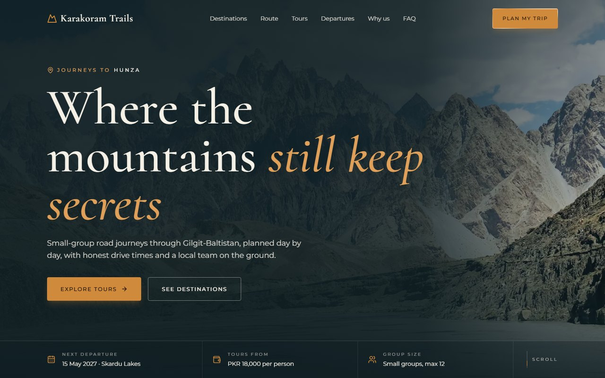

# Karakoram Trails

🔗 **Live:** https://karakoram-trails.pages.dev



Landing page for a Northern Pakistan tour agency (Hunza, Skardu, Fairy Meadows).
Next.js 16 + Tailwind CSS 4 + Framer Motion, exported as a fully static site.

## Develop

Node 22 (`.nvmrc`, `engines` in `package.json`; Cloudflare Pages builds use the same). The `db:*` scripts
run `content.ts` directly with Node's TypeScript support, which needs Node 22.18 or newer.

```bash
npm install
npm run dev
```

## Build and preview the static site

```bash
npm run build     # writes the static site to out/
npm run preview   # serves out/ on http://localhost:4173
```

### Prices and departures in the static HTML (catalog snapshot)

`npm run build` and `npm run dev` first run `scripts/snapshot-catalog.mjs`, which fetches the live
`/api/departures` (D1) and writes `src/lib/catalog-snapshot.json` (gitignored). The static pages and the
admin's drift check are built from that snapshot; the live API still replaces it in the browser, and the
server re-checks prices and seats on every booking.

- **Cloudflare Pages builds** (`CF_PAGES` is set): if the fetch fails or the answer looks wrong, the
  **build fails on purpose**, so Cloudflare keeps the previous good deployment live and stale prices are
  never published. Retry the build (or publish again from the admin) once the API is healthy.
- **Local builds**, or any build with `SNAPSHOT_ALLOW_FALLBACK=1`: the values in `src/lib/content.ts` are
  used instead. Set `SNAPSHOT_ALLOW_FALLBACK=1` in the Cloudflare build variables only for a brand-new
  project's first deploy (before `/api/departures` exists), then remove it.
- `SNAPSHOT_API_URL` points the snapshot at another API, e.g. `http://127.0.0.1:8788/api/departures` to
  build from the local D1.
- `content.ts` prices and departures are now only the seed for a fresh D1 and this fallback;
  `npm run db:check:*` reports differences as notes and fails only when a tour is missing.

## Deploy to Cloudflare Pages

- Framework preset: **Next.js (Static HTML Export)**
- Build command: `npm run build`
- Build output directory: `out`

## Booking backend (Cloudflare Pages Functions + D1)

Stage 1 of the booking system. D1 is the single source of truth for tour prices and departures:
the site renders the `src/lib/content.ts` values in the static HTML, then replaces them in the
browser with `GET /api/departures` (`functions/api/departures.ts`). On hosts without Pages Functions
the request 404s and the static values stay.

- `wrangler.toml`: Pages config, D1 (`DB`) and R2 (`RECEIPTS`) bindings. No secrets.
- `migrations/`: D1 schema. `server/`: server-only code for functions (kept out of the Next build).
- `src/lib/booking-rules.ts`: shared rules. Online booking closes `booking.onlineCutoffHours` (72 h) before
  departure; unpaid holds expire at the earlier of now + `booking.holdHours` (48 h) and that cutoff (only
  `pending_payment` expires). Both numbers, and the deposit percentage, are in `site.config.ts`.

Local development:

```bash
npm run db:migrate:local   # create tables in the local D1
npm run db:seed:local      # insert content.ts tours/departures, then check they match D1
npm run build
npm run pages:dev          # static site + functions + local D1 on http://127.0.0.1:8788
```

`db:seed:*` and `db:check:*` exit with an error if `content.ts` and D1 disagree on a tour name,
price or the upcoming departures. D1 wins: update `content.ts` to match.

One-time production setup (needs your Cloudflare login):

```bash
npx wrangler login
npx wrangler d1 create karakoram-trails     # paste the printed database_id into wrangler.toml
npx wrangler r2 bucket create karakoram-trails-receipts
npm run db:migrate:remote
npm run db:seed:remote
```

### Stages 2–4: checkout, admin, notifications

- Checkout `/checkout/?departure=<id>`, booking status `/booking/?ref=&t=` (WhatsApp "Send booking to us"
  shares details, never the private link), receipt upload to private R2.
- Admin `/admin/`: password login (`/admin/login/`, Turnstile, 5 failed tries per IP per 15 min,
  12 h HttpOnly/Secure/SameSite=Strict signed cookie). Cloudflare Access is also accepted when configured
  (for a custom domain later). Per booking: view receipt, confirm payment, cancel, and "Send confirmation
  on WhatsApp" (message with the reference and the customer's booking link).
- Notifications (`booking_events` outbox, retried up to 5 times, "Retry notifications" in admin):
  Telegram admin alerts (new booking, receipt uploaded); optional n8n webhook (skipped while
  `N8N_WEBHOOK_URL` is empty; `X-KT-Signature: sha256=HMAC_SHA256(secret, "<X-KT-Timestamp>.<body>")`);
  customer emails through the provider in `server/email/provider.ts`, off until `EMAIL_API_KEY` is set.

### Admin: departures and prices (`/admin/#departures`)

- Add a departure (tour, date, seats from 1 to `maxGroupSize`; dates under 72 h away are refused), change
  seat totals (never below booked + held), close or reopen (closing a departure with active bookings lists
  them first), and change tour prices (new bookings only; existing bookings keep their frozen total).
- Season warnings come from `seasonWindows` / `tourSeasonRules` in `src/lib/content.ts`. A warning must be
  acknowledged to add the departure; the acknowledgement is logged.
- Every change is logged in `admin_events` (who, what, old and new value) and shown in the change log.
- A banner lists any difference between D1 and the `content.ts` fallback; update `content.ts` and redeploy
  to clear it. `npm run db:check:*` does the same check from the terminal.
- `maxGroupSize` in `content.ts` is the one group-size setting (admin, checkout, site text). The database
  also caps one booking at 12 travellers, so going above 12 needs a migration.
- Local testing without the password: `npx wrangler pages dev out --port 8788 --ip 127.0.0.1 --binding
  ADMIN_DEV_EMAIL=dev@local.test --binding ADMIN_EMAILS=dev@local.test` (honoured on localhost only).

### Admin: "Publish changes to site"

The button starts a Cloudflare Pages build through a deploy hook; the build snapshots D1 (see above), so
the drift banner clears once the new deployment is live (reload the admin after 2 to 3 minutes).

- One attempt every 2 minutes for all admins together, failed attempts included. Every attempt is logged
  in `admin_events` (`site_publish_requested`, then `site_publish_started` or `site_publish_failed`).
- If a publish started more than 5 minutes ago and the admin still shows differences, the banner says
  "Publish may have failed: check Cloudflare deployments" (a failed snapshot stops the build by design).
- Setup (once): Cloudflare dashboard → Workers & Pages → karakoram-trails → Settings → Builds → Deploy
  hooks → add a hook for branch `main`, then store its URL as a secret (paste it at the prompt):
  `npx wrangler pages secret put DEPLOY_HOOK_URL --project-name karakoram-trails`.
  The URL starts builds for anyone who has it: never commit it or send it in chat. The server only calls
  URLs under `https://api.cloudflare.com/client/v4/pages/webhooks/deploy_hooks/`.
- Without `DEPLOY_HOOK_URL` the button is replaced by "Publishing isn't configured yet".

Before going live:
1. Turnstile widget for `karakoram-trails.pages.dev`: put its public **site key** in `.env.production`
   (`NEXT_PUBLIC_TURNSTILE_SITE_KEY`, committed; read by `next build`). `TURNSTILE_HOSTNAMES` and
   `PUBLIC_SITE_URL` are in `wrangler.toml` `[vars]`.
2. Secrets (each command prompts for the value; set them before the deploy that needs them; `DEPLOY_HOOK_URL` is optional, see "Publish changes to site"):
   `npx wrangler pages secret put NAME --project-name karakoram-trails` for `TURNSTILE_SECRET_KEY`,
   `ADMIN_PASSWORD_HASH`, `SESSION_SECRET` (both from `node scripts/hash-admin-password.mjs`),
   `TELEGRAM_BOT_TOKEN`, `TELEGRAM_CHAT_ID`, `BANK_NAME`, `BANK_ACCOUNT_TITLE`, `BANK_IBAN`, `RAAST_ID`.
   Optional: `N8N_WEBHOOK_URL`, `N8N_WEBHOOK_SECRET`, `EMAIL_API_KEY`, `MAIL_FROM`.
3. Never set `TURNSTILE_ALLOW_TEST_KEYS`, `ADMIN_DEV_EMAIL` or `TELEGRAM_API_BASE` in production.
4. `npm run db:migrate:remote` (applies any new migrations, e.g. `0005_admin_events`).

## Photos

Originals live in `photos-original/`. After adding or replacing a photo, update the file map in
`scripts/optimize-images.mjs` and run:

```bash
npm run optimize-images
```

This writes responsive AVIF and WebP files (400 px up to 1920 px for the hero) to `public/images/`, one photo
per slot, lowering quality and lightly denoising until each file fits its budget (hero up to 300 KB, everything
else under 150 KB; AVIF gets 75% of that). An entry can also cap the starting quality with `maxQuality`: the
hero's AVIF is capped at q45, which looked the same as q60 under the hero scrim. File names carry a hash of their bytes
(`name-1280.3f9a1c2b.avif`), so `/images/*` is cached for a year; a changed photo gets a new name.
It also writes `src/lib/images.generated.json` (sizes, intrinsic width/height and a ~200-byte blur
placeholder per photo), which `src/lib/images.ts` and `<Photo>` read: `<picture>` with AVIF first, WebP as
the fallback, width/height on the ``, and the placeholder as its background until the photo paints.
Commit `public/images/` and the manifest after running it.

## How to rebrand

Everything that makes this site "Karakoram Trails" is in one file, `site.config.ts` in the repo root. The
pages, the Pages Functions (booking rules, customer emails) and the build scripts all read from it.

1. **Name and contact:** `name`, and `contact` (phone as shown, WhatsApp number as digits with the country
   code, email, office address, reply hours). `social`: profile URLs; empty ones are not shown.
2. **Logo:** `logo.mark` is `"mountain"` (the built-in mark) or the path of your own SVG in `public/`, for
   example `"/logo.svg"`. The browser-tab icon is a separate file: replace `src/app/icon.svg`.
3. **Colours:** `colors`. Each comment gives today's contrast ratios; the text shades (`apricotDeep` on light
   backgrounds, `apricotBright` on dark ones, `mist`) must stay at 4.5:1 or better, and the hero scrims
   (`.hero-scrim`, `.destination-scrim` in `src/app/globals.css`) were tuned for these colours and photos.
4. **Booking rules:** `booking` (maximum group size, deposit %, hold hours, balance due days, online
   cutoff). The server uses the same values, so a new deploy applies them everywhere. Going above 12
   travellers per booking also needs a D1 migration (`migrations/0001_init.sql` caps it at 12). The rules
   are quoted on /terms, so update `legalMeta.updated` in `src/lib/content.ts` and bump `TERMS_VERSION` in
   `server/bookings.ts` when they change.
5. **Payments:** `payments.methods` and the labels on the booking page. The bank details themselves are
   secrets: `npx wrangler pages secret put BANK_NAME --project-name <project>` (also `BANK_ACCOUNT_TITLE`,
   `BANK_IBAN`, `RAAST_ID`).
6. **Feature flags:** `features.showTestimonials` (turn it on only once `testimonials` in
   `src/lib/content.ts` holds real reviews).
7. **SEO:** `seo` (home page title and description, default social-preview photo, locale). Other pages are
   titled "Page | name".
8. **Address:** `url` is the default. Per deployment, set `NEXT_PUBLIC_SITE_URL` (Cloudflare Pages build
   variable) and, in `wrangler.toml`, `PUBLIC_SITE_URL` and `TURNSTILE_HOSTNAMES`.

Not in the config: tours, destinations, FAQ and legal texts (`src/lib/content.ts`), photos
(`photos-original/` and `scripts/optimize-images.mjs`, see Photos), fonts (`src/app/layout.tsx`), the
Turnstile site key (`.env.production`), and the D1 and R2 names (`wrangler.toml`). After changing anything,
run `npm run build` and check the pages before deploying.

## Before launch

- **Legal pages need review by the business owner.** `/terms/`, `/privacy/` and `/refund-policy/` were
  written from the booking rules in code and the owner's instructions, not by a lawyer. Review them before
  relying on them. Refund rules come from `cancellationPolicy` in `src/lib/content.ts` (also used by the FAQ
  and checkout); booking numbers from `bookingTerms`. When the texts change, update `legalMeta.updated` and
  bump `TERMS_VERSION` in `server/bookings.ts`. `legalMeta.draft = true` shows a "Draft" banner on all three.
- Anything still marked `PLACEHOLDER` in `src/lib/content.ts` (for example `USD_RATE` and reply hours).
- Prices and departures live in D1; keep `content.ts` in step (`npm run db:check:remote`).

## Backlog

- **Android font fallbacks.** next/font's automatic fallback fonts are metric-matched to Times New Roman
  (for Cormorant) and Arial (for Montserrat). Android phones have neither, so they show Noto Serif / Roboto
  without size-adjust until the web fonts arrive, and text can move when they swap in. Fix: add fallback
  `@font-face` rules for Noto Serif and Roboto with their own `size-adjust` and ascent/descent overrides,
  listed after the current fallbacks. So far the swap was only measured on Windows (CLS 0.002 at most with
  the fonts held back 2.5 s).
- **Uppercase labels in the fallback font.** The Arial fallback is sized for Montserrat's lowercase, so
  spaced-out uppercase labels come out wider and can wrap onto an extra line until Montserrat arrives. The
  tour-page route is split by hand on phones for this reason. One case is left: on the home page with
  reduced motion, at 360-379 px, the list of places in the hero eyebrow takes one more line in the fallback
  (CLS 0.013 when the fonts arrive late). A separate fallback face for uppercase labels, with its own
  `size-adjust`, would fix both.

## Build notes

`npm run build` also runs `scripts/flatten-segment-files.mjs` (as `postbuild`). Next.js 16.3 writes the
prefetch files of dynamic routes (`/tours/[slug]`) into nested folders while the browser asks for
dot-joined names; the script adds the flat copies so tour-page links don't 404. It can be removed once
Next.js fixes this.

## Credits

Components
- Hero adapted from "Layer Parallax Hero" by erikvalencia1 on 21st.dev
- Magic UI (magicui.design): Shine Border, Blur Fade, Marquee, Scroll Progress, Word Rotate, Text Reveal,
  Number Ticker, Animated Beam, in `src/components/magicui/`
- shadcn/ui: Accordion, Toggle, Toggle Group, Input, Textarea, Label, in `src/components/ui/`
- Call-to-action buttons (`src/components/ui/cta-button.tsx`), pinned destinations, route map and tour pages were built for this site

Photos: every photo, with its photographer, source (Pexels or Unsplash) and licence, is listed on `/credits/` and
in `public/images/CREDITS.md`, both generated from the `credit` entries in `scripts/optimize-images.mjs`.